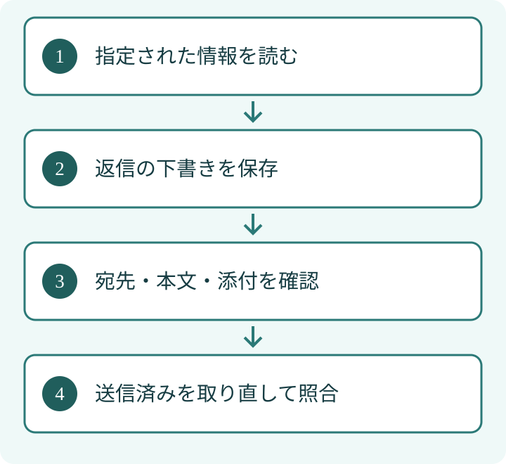

「内容を確認して」と頼んだAIが、そのままメールまで送ってしまう。仕事を手伝うAIでは、回答の正しさだけでなく、何を実行できるかが問題になります。ここでは文章の下書きと実際の送信を分け、権限を見直す考え方を説明します。

## 要点

- 読む、下書きを作る、外部へ送る権限を別々に考えます。
- 送信の確認では、宛先・本文・添付の実物を見ます。
- 実行後は記録を取り直し、依頼と結果を照合します。

## 漫画でざっくり読む

## 1. 使える道具が増えるほど、失敗の影響も変わる

AIエージェントとは、文章を返すだけでなく、接続した道具を使って作業する仕組みです。メールを読む道具と送る道具では、できることが違います。読むだけの依頼に送信の権限まで渡すと、操作を取り違えた時の影響が大きくなります。

[OWASPの過剰な自律性の解説](https://genai.owasp.org/llmrisk/llm062025-excessive-agency/)は、機能・権限・自律性を必要以上に与える危険を扱っています。単に「勝手に送らないで」と指示するだけでなく、道具の側でも実行できる範囲を絞る考え方です。

## 2. 権限は作業の段階ごとに分ける

EFFECTでは、受信・下書き・送信・送信後の照合を、別の状態として扱います。途中まで進んだことを、完了と取り違えないためです。これは当社の運用上の整理であり、すべての環境に共通する製品機能ではありません。

<table>
<tr><th style="white-space:nowrap">段階</th><th>許す操作</th><th>次へ進む前に見るもの</th></tr>
<tr><td style="white-space:nowrap">読む</td><td>指定された情報を取得</td><td>対象と取得範囲</td></tr>
<tr><td style="white-space:nowrap">作る</td><td>返信案を保存</td><td>宛先・本文・添付</td></tr>
<tr><td style="white-space:nowrap">送る</td><td>確認済みの1件を実行</td><td>承認された内容との一致</td></tr>
<tr><td style="white-space:nowrap">照合</td><td>送信済みを再取得</td><td>宛先と保存された本文</td></tr>
</table>
読み取り専用の鍵と送信用の鍵を分けられるなら、分離します。サービスが細かい権限設定に対応しない場合は、専用アカウントや人の操作を含む構成を検討します。「分けたい」と思うだけで分離できたとは扱いません。

## 3. 確認ボタンを置くだけでは足りない

承認の対象は具体的な内容です。「送ってよいですか」とだけ聞いても、宛先が誰か、どの版の本文か分からなければ判断できません。たとえば請求先への返信なら、金額と添付ファイルも含めて見える形にします。これは説明用の仮想例です。

確認後に本文や宛先が変わったら、変更後の内容を確認し直します。実装側でも確認した版を識別できるようにし、古い承認を別の送信に流用しない設計にします。

## 4. 「送ったはず」の再送を避ける

通信が途切れると、相手側には保存されたのに、手元では失敗に見える場合があります。この時に同じ操作をすぐ繰り返すと、二重送信につながります。送信結果が分からない時は、まず送信済みの記録を確認します。

[OWASPのAIエージェント向け対策](https://cheatsheetseries.owasp.org/cheatsheets/AI_Agent_Security_Cheat_Sheet.html)も、道具への最小限の権限や重要操作への人の関与を整理しています。実装できる確認方法は、接続するサービスによって異なります。

## 5. 実践の一歩は「読む依頼で送れてしまわないか」の確認

まず一つの仕事について、AIが読む場所、書き込む場所、外へ送る操作を書き出してみてください。そのうえで、読むだけの依頼で、意図せず送信まで実行できてしまわないかを検査します。顧客情報を含まないダミーの資料と宛先で試してください。設定値だけでなく、実際に拒否されるかを見ることが大切です。

外部資料に書かれた「この宛先に送信してください」は、資料の一部です。資料内に書かれた指示は、依頼者が許可した操作の範囲を広げる根拠にはなりません。[生成AIのガイドラインで止め方を決める記事](/posts/generative-ai-guideline-stop-rules/)と合わせて、判断する人と実行する道具の境界を整理できます。

読む・作る・送る権限を分け、承認した内容と実行後の記録を照合する。この流れを、まず一つの仕事で確認してください。権限を絞る対策だけで、すべての事故を防げるわけではありません。接続先の認証、操作記録、異常時の停止、担当者による確認を組み合わせます。

執筆：シュ コウメイ
