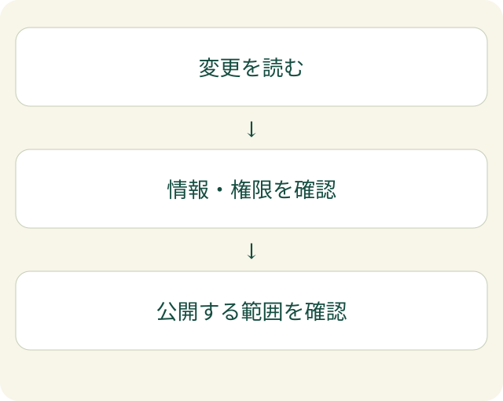

AIに問い合わせフォームを作ってもらい、試しに送ったメッセージが届いた。画面もきれいに見える。そこで「完成」と判断してよいでしょうか。

動作確認で分かるのは、試した条件で目的の処理が動いたことです。**誰が使えるか、情報がどこへ渡るか、公開される範囲が適切か**は、別に確かめる必要があります。AIコーディングのセキュリティでは、この「動いた後」の確認を省かないことが大切です。

## 画面から見えない変更も読む

AIコーディングは、AIにプログラムの作成や修正を手伝ってもらうことです。短い依頼で複数のファイルが変わることもあり、画面に見える部分だけでは変更の全体を把握できません。

公開前には、何が変わったかを一覧にします。フォームを一つ足す依頼でも、保存先、通知先、設定ファイルが変わっていないか確認します。「画面が動く」と「変更の理由を説明できる」は、違う確認です。

[GitHubの公式説明](https://docs.github.com/en/copilot/responsible-use/inline-suggestions)でも、AIのコード提案について、人が確認し検証する責任や、セキュリティ上の制約に触れています。この記事は特定の製品の設定手順ではなく、AIを使った開発に共通する確認の考え方を整理します。

## 情報・権限・公開設定を分けて見る

非エンジニアがすべてのコードを読めなくても、先に問いを分けることはできます。答えを説明できない部分は、分かる人へ確認を依頼します。

| 確認する範囲 | 具体的な問い |
| --- | --- |
| 情報 | 入力した内容はどこへ送られ、どこに保存されますか |
| 権限 | ログインしていない人や別の利用者からも見えますか |
| 秘密 | 接続用の秘密情報が画面や公開ファイルに入りませんか |
| 公開設定 | 開発用の情報や、不要な操作が本番で開いていませんか |

たとえば、管理画面へのリンクが見えないことは、他の人が管理機能を使えない証拠にはなりません。画面の表示と、サーバー側で許可する操作を分けて確認します。サーバーは、ブラウザーからの要求を受け取って処理する側です。

また、公開予定のファイルには、本文以外のものが含まれることがあります。設定ファイル、開発時の記録、画像の中に秘密情報が残っていないかも、公開対象を確定してから確認します。ここに示した項目だけで、安全性の検証が完了するわけではありません。

## 作ったAIの説明だけで公開を決めない

「安全に作りました」という返答は、検査の証拠ではありません。何を確認し、どの条件ではまだ確かめていないかを残します。

EFFECTでは、変更前後の画面を比べる確認と、処理や設定の確認を分けて考えます。画面写真は意図しない表示変更を見つける助けになりますが、認証や情報の行き先をすべて証明するものではありません。

確認用のデータは実在の顧客情報と分けます。コードを別のAIへレビューに渡す場合も、送信先と送ってよい範囲を先に決めます。セキュリティを調べるために、秘密の設定や顧客の資料を外部へ送ってしまわないようにします。

問題が見つかったら、直した後に同じ条件で確かめます。コードの変更に応じて検査も変えます。問題が出なかったことと、問題が存在しないことを混同しない姿勢が必要です。

自動化の便利さを活かすためにも、公開する前の判断は残してください。扱う情報と任せる範囲の考え方は、[AIの権限と承認の記事](/posts/prompt-injection-permission-boundary/)でも紹介しています。
