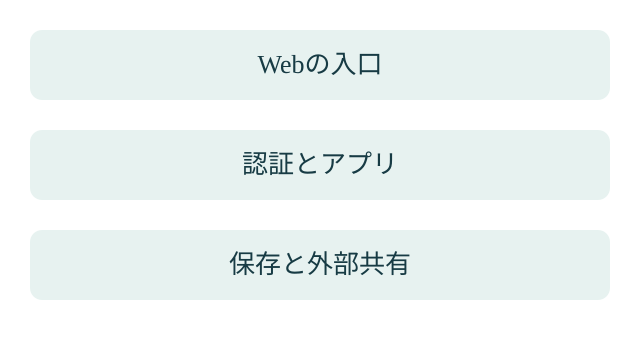

韓国の金融機関を狙う攻撃に、AIを使う侵入テストの道具が悪用された。CrowdStrikeが2026年10月7日に公表した分析です。AIで攻撃されたと聞くと、「AI対策のサービスで防げるのか」と考えたくなります。先に確かめたいのは、どの入口と情報を守るのかです。

**AIシールドが役立つ範囲と、別の対策が必要な範囲を分けます。** 個別の事件について「導入していれば防げた」とは断定しません。公表された事実と、EFFECTとして勧める確認の手順を整理します。

> **TL;DR**
>
> AIを使った攻撃でも、守る対象はWebの入口、アカウント、アプリ、保存した情報などに分かれます。AIシールドはサイトの監視や入口の防御を扱います。事件の防止を保証せず、自社の構成と必要な対策を照合して判断します。

## 今回の攻撃では何が確認されていますか？

**AIを使う道具の利用痕跡は確認されていますが、侵入経路の全体は確定できません。** CrowdStrikeは、攻撃者側の公開ディレクトリからARTEXの設定やAI利用の記録を得たと説明しています。ARTEXは、侵入テストをAIと連携して進める道具です。[CrowdStrikeの分析](https://www.crowdstrike.com/en-us/blog/unknown-threat-actor-uses-artex-to-target-south-korean-finance/)

報告では、金融機関のローン進捗照会サービスや従業員向けの業務支援システムに被害があったという報道にも触れています。ただし、被害を受けた組織数は未確認としています。攻撃者の属性も確定した事実としては扱われていません。

[ITmediaによる報道](https://www.itmedia.co.jp/news/article/2610/09/2000002176/)も確認しました。本記事では、攻撃者とされる人物の個人情報ではなく、守る側が確認できる入口と情報の範囲に注目します。

この公表資料だけで、各社の認証や更新状況、防御製品の設定まで分かったわけではありません。原因を一つに決め、製品を置けば解決すると結論づける材料にはしません。

## 国内の報道から何を分けて考えますか？

**漏洩の発表と、AIが使われたという推定を分けます。** 指定された[Yahoo!ニュースのトピックス](https://news.yahoo.co.jp/pickup/6598186)は、企業の情報漏洩と政府による対策要請を伝えています。そこに載る[JR東日本の2026年10月9日の発表](https://www.jreast.co.jp/press/2026/20261009_ho02.pdf)では、外部のメール配信サービスへの不正アクセスに伴い、メールアドレスなどが閲覧・取得された可能性を否定できないとしています。「漏洩が確定した」という表現には置き換えません。

この事例で確認したいのは、自社サイトの外にも会員情報が置かれていることです。自社のWeb入口に対策を施していても、外部の配信サービスまで同じ防御を通るとは限りません。委託先、渡す情報、権限、異常時の連絡を別に確認します。

[読売新聞の報道（Yahoo!ニュース掲載）](https://news.yahoo.co.jp/articles/23cc7d620525131de0cf61bc3ae2bba4baaf0a0c)は、広い範囲で起きた漏洩と、AIによる弱点探索の可能性について専門家の見方を伝えています。この見方だけで、国内の個別事件すべてにAIが使われたとは判断できません。本記事では、集計数を防御の効果の根拠には使いません。

国内の委託先の事例と、ARTEXの利用痕跡が確認された韓国の事例は、同じ侵入経路ではありません。EFFECTでは、ニュースの「AI」という言葉よりも、情報が置かれる場所とアクセス経路を先に確認します。

## AIシールドはどこを守るサービスですか？

**サイトへ来るアクセスを見て、入口の対策を整えるサービスです。** 現在の[AIシールドの案内](https://effect.moe/aishield/)では、サイト内部の入口、サーバー会社の機能、前段のアクセス確認を分けています。

前段の門番は、サイトへ届く前に通信を確認する仕組みです。WAFはWebへの通信を検査する防御機能ですが、何でも判定できるものではありません。対象の通信がそこを通り、必要な設定があるかを確かめます。

見守りは、アクセスの監視と状況の通知です。前段の門番やサーバー内の対策は別の設置作業として案内されています。見守りを契約しただけで、設置まで終わったと捉えないことが大切です。

## 防御はどの範囲に分けて考えますか？

**サイトの外側だけでなく、認証とデータの扱いも見ます。** 下の表は、一般的な検討範囲です。今回の事件で各対策が実施されていたかを示すものではありません。

| 確認する範囲 | 確認したいこと | AIシールドとの関係 |
|---|---|---|
| Webへのアクセス | 異常な探索、偽装、繰り返しの試行 | 監視や入口対策を検討する範囲 |
| アプリの状態 | 脆弱性の修正、公開してよい機能 | 管理者・開発者の対応と分けて確認 |
| アカウント | 権限、認証、不要な利用者 | Webの門番だけでは代替できない |
| 保存と共有 | 機密の置き場、共有範囲、持ち出し | 情報管理と業務のルールも必要 |
| 被害が起きた後 | 調査、復旧、通知の担当 | 緊急対応は別途確認が必要 |

悪質なアクセスを入口で減らせても、正規の権限で読めてしまうデータや、盗まれたアカウントの問題が残る場合があります。対策した範囲の外にあるものを、守ったことにはしません。

## 導入するか、何を基準に決めますか？

**守りたい情報と、現在の入口が分かるところから判断します。** EFFECTでは、まず構成とログを確認し、必要な対策を決める進め方を勧めます。

公開フォーム、ログイン画面、会員情報などを持つサイトでは、入口やデータの扱いを確認する必要があります。一方、サイト以外のメール、端末、外部サービスの問題が主な課題なら、Webの防御だけを先に増やしても課題が残ります。

相談時は、サイトの構成、扱う情報、管理者、既存の防御、分かっている異常を整理します。ログがない項目は不明と残します。調べるために、顧客情報やパスワードの原文を相談用の表へコピーする必要はありません。

## 相談前に何を用意すればよいですか？

**守る範囲と、現時点で分からないことを一枚にします。** 被害の発生を確認した場合は、導入検討の話とは分け、既存の管理担当と緊急対応を進めます。

通常の見直しなら、次の順で整理できます。

1. 公開サイト、管理画面、保存データを分けます。
2. 既存の防御と、実際に通っている経路を確認します。
3. 見守り、入口の設置、内部の修正を分けて見積もります。
4. 設置後に、正規の閲覧や業務を妨げていないか検証します。
5. 状況を通知する担当者と、異常時の連絡先を決めます。

AIシールドで今回の事件を防げたかは、公開資料だけでは判断できません。自社へ必要かを決めるには、[AIシールドの相談](https://effect.moe/aishield/)で守りたい情報と現状の構成から確認します。
