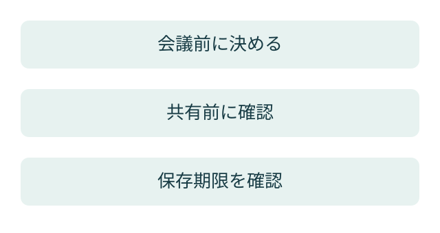

「録音は消しました。でも、要約を送ったメールは残っています」。説明のための架空の場面です。AI議事録では、録音を消しただけで会議の情報を消せたとは限りません。文字起こし、要約、共有先のコピーを分けて確認します。

**AI議事録のセキュリティは、作成後の保存と共有まで含めて決めます。** ここでは、会議を開く前に決めることと、終わった後に確かめることを整理します。

> **TL;DR**
>
> 録音・文字起こし・要約は別の記録です。保存場所、閲覧できる人、削除する時期をそれぞれ決め、共有先へ複製した内容も確認します。

## AI議事録では何が残りますか？

**音声と、音声から作った文章を分けます。** AI議事録は、会議の発言から文字起こしや要約を作る仕組みです。利用する機能によって、録音を保存するもの、要約だけを保存するものなどがあります。

たとえばZoomの会議要約には、要約を自動削除する設定があります。[Zoomの会議要約の自動削除](https://support.zoom.com/hc/en/article?id=zm_kb&sysparm_article=KB0075089)。これは会議要約の設定です。録画や、別の場所に保存した文章も同じ設定で消えると決めつけません。

EFFECTでは、保存する情報を次のように書き分ける方法を勧めます。下の表は確認用の書式です。製品の既定値を示したものではありません。

| 記録 | 保存場所 | 閲覧できる人 | 削除・見直しの時期 |
|---|---|---|---|
| 録音・録画 | 実際の保存先を記入 | 権限のある人を記入 | 会社が決めた時期 |
| 文字起こし | 実際の保存先を記入 | 同上。要約と別に確認 | 同上 |
| 会議要約 | 実際の保存先を記入 | 自動共有の対象も確認 | 同上 |
| メール・共有フォルダのコピー | 複製先を記入 | 配布先とリンクの範囲 | 複製先での削除方法 |

## 会議が始まる前に何を決めますか？

**使う機能と、扱う話題と、共有相手を決めます。** 会議招待の文面に「要約を作ります」とだけ書いても、誰がどの内容を読めるかは分かりません。

最初に、AIによる要約を使うこと、担当者、保存先、共有範囲を参加者へ説明します。扱う話題に機密情報が含まれる場合は、会社の情報管理ルールと利用契約を確認します。判断できない話題は、録音や要約を始める前に管理担当へ確認します。

サービスの設定は、アカウント全体、グループ、利用者で管理する場合があります。Zoomの自動削除もこの単位ごとの設定が案内されています。設定を変更できる人と、固定されている設定を確認します。自分の画面に項目がないからといって、設定されていないとは限りません。

## 誰に共有するかをどう確かめますか？

**共有前に、要約の内容と宛先を見ます。** 会議に参加した人すべてへ、同じ要約を渡してよいとは限りません。招待者、実際の参加者、外部の協力者を区別します。

たとえば架空の打ち合わせで、予定を決めた後に社内だけの人事の話が続いたとします。予定の合意だけを渡すつもりでも、全文の要約には後半の話が入る可能性があります。外部へ渡す文面は、必要な内容を取り出して確認します。

EFFECTが重視するのは、元の記録と外部へ渡す文章を分けて管理することです。「短くしたから安全」とは判断しません。短い要約にも、人名、未公表の計画、個別の条件が残る場合があります。

リンク共有を使うなら、ログインが必要か、特定の相手だけか、有効期限があるかを確かめます。リンクを送った宛先の確認と、リンクを開ける範囲の確認は別です。

## 削除したことはどう確認しますか？

**どの記録を、どこから消したかを残します。** 要約の自動削除を有効にしても、メールで送ったコピーやダウンロードしたファイルまで消えた証明にはなりません。

保存期間は一律の数字をここで決めません。業務で必要な期間、社内ルール、利用する機能の設定に合わせます。記録を持つ担当者が、期限と削除方法を確認します。

確認のためだけに議事録全文を別の表へ貼り付ける必要もありません。対象の種類、保存先、担当者、確認日、結果、残っているコピーの有無を記録すれば、内容を複製せずに管理できます。

## AI議事録を試すときは何から始めますか？

**機密を含まない練習用の会議で、作成後まで確認します。** 要約が便利かどうかと、情報の扱いが適切かどうかを、同じテストで見ます。

1. 録音・文字起こし・要約のうち、何を作るか決めます。
2. 保存先と共有先を確認します。
3. 練習用の会議で要約を作り、内容と宛先を見直します。
4. コピーした場所を記録し、各保存先の削除方法を確かめます。
5. 実務へ移す前に、担当者と運用ルールを決めます。

まずは一つの会議について、保存・共有・削除の表を埋めます。空欄は「不明」と書いて確認先を残せば、次に調べることが分かります。
