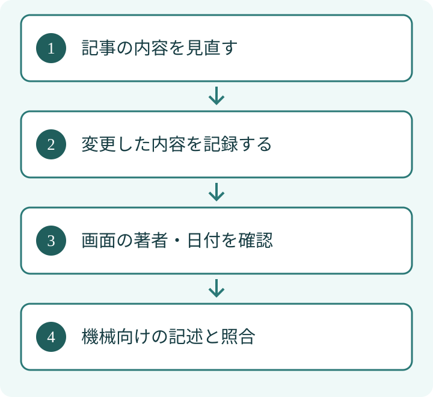

記事の画面には昨日更新と書かれているのに、検索向けの記述では先月のまま。著者名も別の名前になっている。記事の構造化データは、付け足す前に、読者が見ている内容と一致しているかを確認しましょう。

## 要点

- 著者・題名・公開日・更新日を、画面と記述で照合します。
- 日付だけを新しくして、記事を新しく見せる運用を避けます。
- 記述の一致は、AIによる引用や検索表示の保証ではありません。

## 漫画でざっくり読む

## 1. 記事を説明する名札として考える

構造化データは、検索する仕組みなどへページの意味を伝える記述です。記事には `Article` や `BlogPosting` などの種類があります。題名、著者、日付などは、本の奥付や表紙の名札に近い役割で考えると整理できます。

[Googleの記事の構造化データの説明](https://developers.google.com/search/docs/appearance/structured-data/article)では、著者や画像、公開・更新日時などの項目が紹介されています。利用する項目の要件は、実装時に現在の公式説明で確認してください。

## 2. 同じ記事について、四つの場所を見る

①管理画面の入力、②ページのソース（機械向けの記述）、③読者が見る画面、④実際の記事内容を並べます。下の表は、このうち画面と記述を照合する項目です。表示だけ直しても、別の場所から古い情報が出力され続けることがあります。

<table>
<tr><th style="white-space:nowrap">項目</th><th>画面で見るところ</th><th>記述で見るところ</th></tr>
<tr><td style="white-space:nowrap">題名</td><td>ページの大見出し</td><td>headline</td></tr>
<tr><td style="white-space:nowrap">著者</td><td>執筆者名・プロフィール</td><td>author</td></tr>
<tr><td style="white-space:nowrap">公開日</td><td>最初の掲載日</td><td>datePublished</td></tr>
<tr><td style="white-space:nowrap">更新日</td><td>内容を更新した日</td><td>dateModified</td></tr>
</table>
EFFECTでは、検査ツールで形式に問題がないことと、本文の内容に一致していることを分けて考えます。形式の検査が通っても、別人の著者名や誤った日付が正しくなるわけではありません。

## 3. 更新日には、変更内容の根拠を残す

記事の制度説明が変わった、手順を検証し直したなど、何を更新したか記録しておくと、後から更新日の妥当性を判断しやすくなります。一方、内容を変えずに日付だけ毎日置き換えると、読者が記事の新しさを誤解するおそれがあります。

[Googleの日付に関する説明](https://developers.google.com/search/docs/appearance/publication-dates)では、ページ上の日付や構造化データなど複数の情報を使って判断することが説明されています。サイト側の指定だけで、検索結果の日付を自由に決められるわけではありません。

## 4. 著者を増やす前に、誰が書いたかを明確にする

編集者、執筆者、監修者は同じ役割ではありません。見栄えのために実際に関与していない人を著者へ追加しないでください。著者のプロフィールへのリンクも、その人を説明する実在のページか確認します。

たとえば編集部名で発信するなら、個人名と混在していないかを確認します。個人が執筆しているなら、記事の署名、プロフィール、記述が同じ人物を指すかを照合します。これは運用を決めるための例で、特定の名前の書き方を強制するものではありません。

## 5. LLMOでは「名札の整合」と「回答への採用」を分ける

LLMOは、AIの回答で扱われることを意識し、情報の伝え方を整える取り組みです。記事情報をそろえることは、読者にも機械にも内容を伝える基礎整備です。しかし、それだけでAIが記事を引用する、検索順位が上がるとは約束できません。AIの回答に採用されるかを調べたい場合は、別に条件をそろえて観測します。

[会社情報の構造化データをそろえる記事](/posts/organization-company-information-consistency/)と同じく、まず事実の出所を一つにします。記事では「この著者名と日付を、どこから出しているか」を確認すると、修正漏れを減らせます。

更新後は画面とソースを取得し直してください。古い表示が残る仕組みがある場合は、その影響も区別します。著者と日付をそろえたうえで、検査結果、画面表示、実際の変更内容を照合します。確認できた範囲を記録し、検索結果やAIの回答への採用とは分けて扱ってください。

執筆：シュ コウメイ
