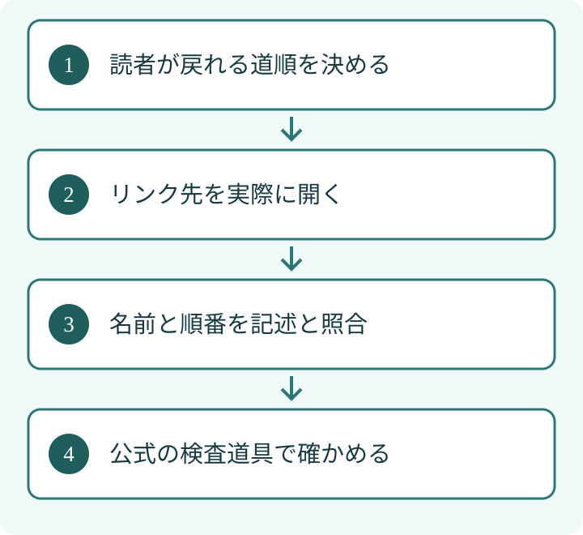

パンくずは、ページの上にある「ホーム → コラム → 記事」のような道順です。検索する仕組みにも同じ関係を伝えるのが、パンくずの構造化データです。まず読者がたどれる道順を整え、その内容を機械向けの記述とそろえます。

## 要点

- パンくずはページの位置関係を示します。
- URLの区切りをそのまま並べる必要はありません。
- 検査合格は、検索結果への表示を保証しません。

## 漫画でざっくり読む

## 1. 先に「読者に戻ってほしい場所」を決める

たとえば料理教室のサイトで、ある記事を「ホーム → 料理の基礎 → 包丁の使い方」に置くとします。これは説明用の仮想例です。読者が一つ前の「料理の基礎」を押して、関連する記事を探せるなら、道順として役に立ちます。

[Googleのパンくずの公式説明](https://developers.google.com/search/docs/appearance/structured-data/breadcrumb)は、サイト内でのページの位置を示すものと説明しています。URLの文字列に合わせるよりも、利用者がサイト内をたどる一般的な順序を表すことが勧められています。

## 2. 表示と記述を並べて照合する

構造化データとは、ページの意味を検索の仕組みなどに伝える記述です。パンくずには `BreadcrumbList` という種類を使います。画面に見える道順と、記述された名前・リンク先を並べると、不一致を見つけやすくなります。

<table>
<tr><th style="white-space:nowrap">確認するもの</th><th>画面の例</th><th>記述で照合するもの</th></tr>
<tr><td style="white-space:nowrap">名前</td><td>料理の基礎</td><td>name</td></tr>
<tr><td style="white-space:nowrap">行き先</td><td>基礎記事の一覧</td><td>item</td></tr>
<tr><td style="white-space:nowrap">順番</td><td>ホームの次</td><td>position</td></tr>
</table>
EFFECTでは、記述の検査結果だけで終えず、読者が見える本文やリンク先との一致を確かめる方針です。パンくずでも、検査画面の緑色だけで正しいと決めず、実際の移動先を確認します。

## 3. 見えない分類を、検索向けだけに足さない

検索に評価されそうな言葉を入れるため、実在しないカテゴリをパンくずに足すのは避けます。カテゴリのページが存在しても、内容が空だったり無関係だったりすれば、読者の道順として役立ちません。

最後の項目のURLなど、指定方法には公式の要件があります。実装時は現在の説明を確認してください。この記事はすべての実装方式に使える完成コードを示すものではありません。

## 4. スマホの検索結果に出ないことと、不備を分ける

Googleは[2025年の表示変更](https://developers.google.com/search/blog/2025/01/simplifying-breadcrumbs)で、モバイル検索結果の表示を簡素化し、パンくずを表示しない形へ変更したと説明しています。検索結果の見た目だけで、記述に不備があると断定できない理由の一つです。

また、正しい構造化データでも検索結果に表示される保証はありません。サイトの画面、記述の検査、検索結果の表示を、それぞれ別に確かめます。将来の表示仕様の変更もあり得ます。

## 5. LLMOの効果を言い切らない

LLMOは、AIの回答で扱われることを意識し、情報の伝え方を整える取り組みです。パンくずを付けたからといって、AIの回答に会社名が出る、引用が増えると約束はできません。まずは読者に分かりやすい位置関係を作り、同じ関係を機械にも伝えるための整備と考えます。

[構造化データの検査結果の読み方](/posts/structured-data-check-reading/)では、記述の正しさと表示の確認を分けています。パンくずでは、さらに「戻り先に読みたい内容があるか」まで確認すると、見せかけの整備を避けられます。

更新後はPCとスマホの両方で、道順の各項目をクリックまたはタップしてください。途中のリンク先が正しいか、長い名前が折り返されるか、現在地が分かるかを確認します。道順が役立つかは、記述の存在だけでは判断できません。読者がたどれる道順を先に整え、画面と記述をそろえ、検索結果の表示とは分けて確認することが基本です。

執筆：シュ コウメイ
