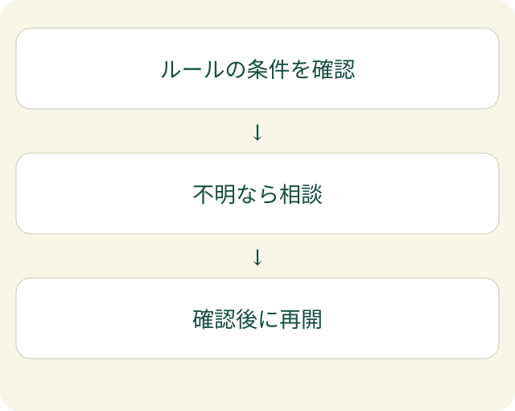

「顧客の名前を消したら、AIに入れてよいですか」。社内ルールに「個人情報は入力しない」とだけ書いてあると、この質問に答えられません。案件の内容や添付ファイルから、相手が分かることもあるためです。これは実在の案件ではなく、判断が割れる場面を示した例です。

生成AIのセキュリティガイドラインには、禁止事項だけでなく、**判断できない時に誰へ確認し、どこで作業を止めるか**も必要です。ここでは、ルールを日々の判断に使える形にする考え方を紹介します。

## 「情報」だけでなく「使い方」を決める

生成AIは、文章や画像などを作るAIです。同じ文章を扱っていても、社内で承認された環境に入力する場合と、担当者が個人で契約したサービスへ送る場合では、確認する条件が変わります。

最初にそろえたいのは、扱う情報、使う環境、AIに任せる操作です。たとえば公開済みの案内文を要約する作業と、顧客へのメールを自動送信する作業を、同じ「AI利用」として許可しないようにします。内容を作る許可が、そのまま外部へ送る許可になるわけではありません。

| 決めるもの | ルールに書く問い |
| --- | --- |
| 情報 | どの情報を扱えますか |
| 環境 | どのサービス・契約・アカウントを使いますか |
| 操作 | 下書きまでですか。保存・送信も含みますか |
| 判断者 | 条件が分からない時、誰へ確認しますか |

EFFECTでは、AIへの指示を「何をしてほしいか」だけで終わらせず、「どこまで任せるか」と合わせて考えます。この整理は、[プロンプトインジェクションへの対策](/posts/prompt-injection-permission-boundary/)にもつながります。

## 判断が割れた時の道を用意する

「安全に使ってください」という一文では、人によって解釈が変わります。判断を分ける道を示したほうが、相談しやすくなります。

この図は、社内運用を考えるための例です。どの情報を許可するかは、契約や業務の条件を踏まえて自社で決めます。「名前を消した」という理由だけで許可へ進めるものではありません。

確認する人には、入力予定の情報の種類、利用先、目的を伝えます。相談のために、禁止された資料をそのまま別のAIへ送らないこともルールに含めます。

公的な指針を社内ルールへ落とす時も、文書をそのまま配るだけでは、個別の業務判断につながらないことがあります。この記事の分岐図は、公式文書の条文や必須手順を転載したものではなく、EFFECTによる運用の整理です。

AIの出力を人が確認する必要性については、[GitHubの責任あるAI利用の説明](https://docs.github.com/en/copilot/responsible-use/inline-suggestions)も参考になります。これはコード提案を対象とする説明です。すべてのAIサービスの条件を同じとみなさず、自社の利用先の条件を確認してください。

## 止めた後に再開できるルールにする

確認が必要な作業を止めても、相談先が不在なら、担当者は待つしかありません。止め方と再開の条件を一組にしておきます。

「誰の回答を待っているか」「何が確認できれば進めるか」「その間に進めてよい作業は何か」を残します。たとえば顧客情報の入力判断を待つ間に、公開情報だけで文章の構成を考えることは、別に検討できます。保留中の情報を使う許可とは区別します。

また、確認した結果はルールへ戻します。同じ質問が何度も来るなら、担当者の注意不足と決めつけず、例が足りない可能性を考えます。禁止の一覧を増やすだけでなく、利用できる例と、確認が必要な例を対で加えると、判断の理由を共有しやすくなります。

生成AIのルールは、配布して終わりではありません。実際に迷った場面を、次の人が判断できる材料にする。そこまで含めて運用すると、使いたい人と守りたい情報の双方に向き合えます。社内の任せ方を整理したい場合は、[AIセントラルの案内](/#ai-central)もご覧ください。
