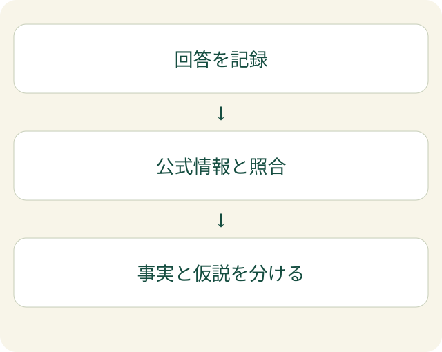

「自社を説明してもらったら、終了したサービスが現役として紹介された」。AI検索で名前が出ても、説明が合っていなければ、その先の問い合わせに誤解が残ります。これは実測結果ではなく、診断で考えたい場面を示した例です。

LLMO診断では、名前が出るかに加えて、**AIが自社をどう説明し、どの情報を根拠にしているか**を確かめます。LLMOは、AI検索で自社の情報が適切に扱われるように整える取り組みです。点数を上げる前に、説明の違いを見つけるところから考えます。

## 回答を見てから、診断する問いを決める

EFFECTでは、まず[AIの動きを観測すること](/posts/llmo-start-ai-crawl-observation/)を出発点にします。サイトへのアクセスや、人の訪問、検索の状況を確認したうえで、AIの回答に何が起きているかを見ます。

「自社を紹介してください」だけでは、幅が広すぎることもあります。会社について知りたいのか、サービスの条件を知りたいのか、他社との違いを知りたいのか。読者が判断したいことに合わせて、質問の範囲をそろえます。

診断する時は、質問文と回答をそのまま残し、日時と利用したAIも記録します。検索を使った回答かどうか、リンクが付いているかも確認します。同じ言葉で聞いても、環境や時点で回答が変わる可能性があります。一度出た説明を、すべての利用者が見る説明とは扱いません。

## 「違う」と思った箇所を分けて確かめる

回答を読んで気になる箇所があったら、すぐにサイト全体を書き直すのではなく、どの記述が何と違うのかを整理します。

| 気になる説明 | 先に確かめたいこと |
| --- | --- |
| 社名やサービス名が違う | 公式ページと公開プロフィールの表記 |
| 終了したサービスが紹介される | 古い案内の残存と、現在の案内の明確さ |
| 条件が断定される | 公式ページに条件や対象が書かれているか |
| 関係ないページへ案内される | 回答のリンク先と、そのページの内容 |

この表は診断の例で、原因を確定するものではありません。AIが古い説明を返したからといって、特定のページだけを参照したとは限りません。リンクが付いた場合も、リンク先が回答全体を裏付けているかは別に読みます。

公式情報にも揺れがあれば、まずその整合性を確認します。回答だけを正したいのに、サイト側で別々の条件を説明していては、どの説明を基準にするか決められません。

## 修正する前に、事実と仮説を分ける

「回答でサービス名が違っていた」は観測した事実です。「会社情報の表記が揺れているためかもしれない」は仮説です。この二つを分けておくと、改善後に何を確かめるかが明確になります。

[GoogleのAI検索機能に関する公式説明](https://developers.google.com/search/docs/appearance/ai-features)では、重要な情報をテキストで示すことなど、検索の基本が引き続き重視されています。この説明はGoogle検索を対象とするもので、ほかのAIの挙動を保証するものではありません。

EFFECTでは、診断を「合格点を出す作業」ではなく、次に確かめる問いを絞る作業として考えます。回答、サイトの内容、公開プロフィールなどを照合し、修正する理由がある箇所を選びます。

変更後にも、条件をそろえて回答を記録します。説明が変わっていても、その変更だけが原因と断定はしません。変わらなければ、同じ文章の修正を繰り返す前に、別の根拠や未確認点を見直します。

「AIに名前は出るけれど、説明が違う」。その時は記事を増やす前に、何がどう違うのかを整理してください。観測から改善を考える入口は、[AIクロールの案内](/aicrawl/)にまとめています。
