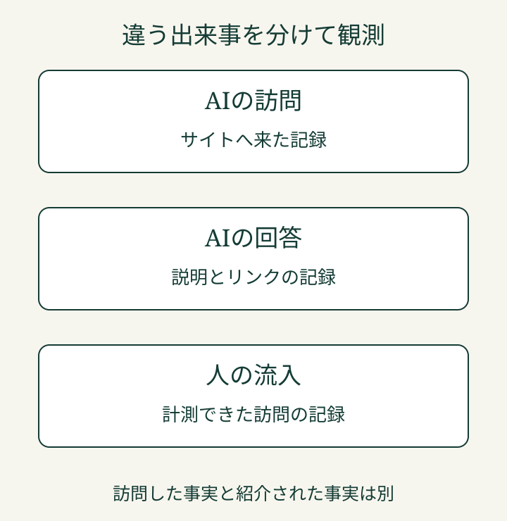

「AIからのアクセスは増えているのに、問い合わせは増えていない」。このとき、アクセス数だけを見ても、次に直す場所は決まりません。

AIがサイトへ来たのか。回答の中で紹介したのか。その案内から人が訪問したのか。LLMOの計測では、**違う出来事を一つの数字にまとめないこと**が大切です。LLMOは、AI検索で自社の情報が適切に扱われるように整える取り組みです。

> **TL;DR** LLMO計測ツールを選ぶ前に、AIの訪問・回答・人の流入のうち何を確かめたいかを決めます。サーバー、GA4、Search Console、AIの回答を重ねて見て、次の改善を考えます。

## 最初に見るのは、AIの動きです

EFFECTでは、LLMO対策を[AIクロールによる現状の観測](/posts/llmo-start-ai-crawl-observation/)から始めます。AIクロールは、AIがサイトへどうアクセスし、利用者へどう案内しているかを把握するための取り組みです。

そのうえで、計測する道具を選びます。「AIに読まれているか」が知りたいのに、回答に名前が出た回数だけを集めても、知りたいことと記録がずれます。反対に、サーバーへのアクセスを数えても、紹介されたことの証明にはなりません。

計測ツールを比べる前に、知りたいことを一文にすると整理しやすくなります。「紹介されない理由を知りたい」「間違った説明が残っているか知りたい」「訪問した人がどこで止まっているか知りたい」。求める答えによって、見る記録が変わります。

## 道具ごとに、見える範囲が違います

サーバーの記録は、サイトへのアクセスを調べる材料です。GA4は、計測できた人の訪問や、その後の行動を調べる材料です。Search Consoleは、Google検索での掲載やクリックなどを調べる材料です。AIの回答を記録すると、実際にどんな案内が表示されたかを確認できます。

| 記録する場所 | 確かめたいこと | それだけでは決められないこと |
| --- | --- | --- |
| サーバー | サイトへアクセスがあったか | 回答で紹介されたか |
| AIの回答 | どの説明やリンクが表示されたか | 見た人がサイトへ来たか |
| GA4 | 計測できた訪問と行動 | AIの全回答での扱われ方 |
| Search Console | Google検索での掲載状況 | 他のAIサービスでの全露出 |

この表は道具の役割を整理したものです。具体的な集計方法やサービスの検査手順を公開するものではありません。

Googleは[AI機能とサイトの案内](https://developers.google.com/search/docs/appearance/ai-features)で、Search Consoleとアクセス解析を使った確認について説明しています。Googleの記録を、他のAIサービスを含む全体の結果だと広げて読まないことが大切です。

## 回答の回数だけで成果を決めない

AIの回答を観測した結果は、その質問と条件での記録です。名前を入れた質問と、サービスを探す一般的な質問では、知りたいことが違います。違う条件の数字を並べて「改善した」と決めると、変化を読み違えることがあります。

また、名前が出ても、終了したサービスを紹介していたら修正が必要です。リンクが出ても、案内先が読者の目的と合っているかは別に確かめます。回数だけでなく、**案内の中身が正しく、次の行動につながるか**を見ます。

数字を増やすことを計測の目的にすると、問題が見えなくなります。「何が起きているかを知り、次に直す場所を決める」という目的に戻すと、見るべき記録を選びやすくなります。

## 重ねて見ると、次の課題が見えてきます

AIの訪問、人の訪問、検索、回答を同じ期間の材料として並べると、調べるべき箇所が見えてきます。ただし、出来事が同時期に起きたからといって、原因と結果が確定するわけではありません。

まず、観測した事実を残します。「AIの回答に古い条件があった」「案内されたページに必要な説明がなかった」といった事実です。その後で、どこを直すと何を確認できるかを考えます。

EFFECTの[AIクロール](/aicrawl/)も、この現状把握を出発点にしています。レポートの中身や検査の仕組みを公開するのではなく、サイトの状態を知ってから改善の順序を考えるための取り組みです。

LLMO計測ツールの選定で最初に決めたいのは、機能の多さよりも「自分たちはAIの何を知りたいのか」です。現状を観測してから、必要な道具を選びます。
