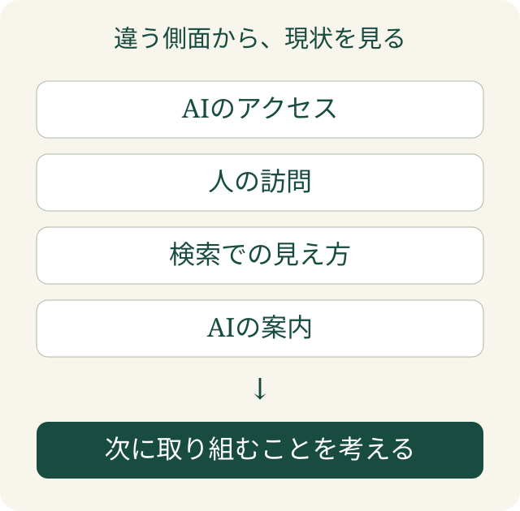

「AI検索からの問い合わせを増やしたい。まず記事を増やそう」。その前に、自社のサイトへAIがどうアクセスし、利用者をどこへ案内しているか、把握できているでしょうか。

**EFFECTが考えるLLMO対策の第一歩は、AIクロールで現状を知ることです。** LLMOは、AI検索で自社の情報が適切に扱われるように整える取り組みです。何を直すかは、実際の動きを見てから決めます。

## LLMO対策は、直す前に観測する

見出しを変える。説明を足す。新しい記事を書く。どれも改善の候補になります。ただ、今どこで機会を逃しているのかが分からなければ、着手する順番を決められません。

AIクロールは、AIによるサイトへのアクセスを観測する入口です。「来ているか」だけでなく、自社サイトとAIの接点に目を向ける。そのうえで、検索の状況や人の行動と合わせて考えます。

大切なのは、観測したことから改善を考える順序です。あらかじめ決めた対策を、どのサイトにも同じように当てはめる進め方ではありません。

## 一つの数字では、次にやることは決まらない

サーバーの記録、GA4、サーチコンソールは、それぞれ違う場面を見ています。GA4はサイトを訪れた人の行動を調べるアクセス解析、サーチコンソールはGoogle検索での見え方を確認するサービスです。これらにAIの回答での案内を合わせると、サイトの状況を複数の側面から捉えられます。

| 見るもの | 考えたい問い |
|---|---|
| サーバーへのアクセス | AIとサイトの接点はどうなっているか |
| GA4 | 訪れた人はどこへ進んでいるか |
| サーチコンソール | Google検索でどう見つけられているか |
| AIの案内 | 自社をどう説明し、どこへ案内しているか |

AIがアクセスしたことと、回答で紹介したことは同じではありません。紹介されたことと、人がサイトを訪れたことも別です。

**これらの記録を照合して、次に確かめることと改善の候補を絞ります。** 各ツールがすべてを記録しているとは限らないため、記録がないだけで「起きていない」と決めつけることも避けます。

Googleも、AIを使う検索機能では、重要な内容をテキストで伝えることや、ページを取得できることなど、[検索の基本を引き続き重視するよう説明しています](https://developers.google.com/search/docs/appearance/ai-features)。この説明はGoogle検索についてのものです。ほかのAIについても、実際の動きを確認して判断します。

## 月次レポートで知りたいのは「次に何をするか」

レポートを開いて、アクセス数を眺めて終わる。それでは、サイトをどう育てるかの判断につながりません。

EFFECTの月次分析では、サイト側の記録と、人の訪問や検索の状況を合わせて、次に取り組むことを考えます。必要に応じてAIの案内も照合します。目指すのは、数字の多い報告書を作ることではなく、**自社の改善をどこから始めるか判断できる状態**です。

観測から得られるのは、改善の根拠と、確かめるべき仮説です。一度の観測で原因がすべて確定するわけではありません。改善した後にも動きを見て、次の判断につなげます。

「うちのサイトは、AIからどう見られているのだろう」。その問いが浮かんだら、記事を増やす前に現状を知るところから始めてください。

[AIクロールの案内を見る](/aicrawl/)
