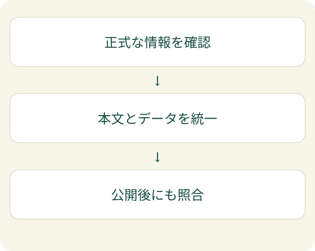

会社概要では正式な社名、サービス紹介では昔の屋号、公開プロフィールでは別の説明。人は前後の文脈で同じ会社だと推測できても、検索する人にとって分かりやすい状態とは言えません。

会社情報の構造化データを考える時は、コードを増やす前に、**名前と説明の基準をそろえる**ことが出発点です。構造化データは、ページの情報を機械が扱いやすい項目に分けて示す形式です。見える本文と別の会社像を作るものではありません。

## Organizationは、会社情報を示す形式

Organizationは、組織の情報を表す種類の名前です。社名、公式サイト、ロゴ、所在地などを、項目として記述できます。

[Googleの公式説明](https://developers.google.com/search/docs/appearance/structured-data/organization)では、ホームページへの組織の構造化データの追加が、組織情報の理解や別の組織との区別を助けるとされています。これは、すべてのAIが必ずそのデータを読むという保証ではありません。書けば回答に選ばれる、とも言い切れません。

EFFECTでは、構造化データだけを整えて終えるのではなく、実際のAIの動きを観測しながら、サイトの説明と照合する考え方を重視します。その入口は、[LLMO対策を観測から始める記事](/posts/llmo-start-ai-crawl-observation/)で説明しています。

## 本文とデータの基準を一つにする

会社紹介の文章は、ページごとに目的が違います。すべての文章を同じにする必要はありません。一方で、社名や現在のサービス条件が、ページによって食い違わないようにする必要があります。

| 情報 | そろえる時の注意点 |
| --- | --- |
| 正式名称 | 法人名と屋号・サービス名の関係を説明します |
| サイトURL | 自社が管理する公式のサイトを示します |
| 事業の説明 | 現在行っていることと、終了したものを区別します |
| 公開プロフィール | 同じ組織だと確認できるページを選びます |

たとえば、屋号を法人名の別名として書く前に、実際にどう使っている名前かを確認します。別の会社、別の運営主体、単なるサービス名を同じ組織として結び付けないようにします。

sameAsは、同じ対象を示す別のページのURLを記述するための項目です。関連するからという理由だけで、取引先やメディア記事を何でも並べるものではありません。Googleの公式例や説明を読み、自社に該当する情報を選びます。

## 名前をそろえた後も、回答を確かめる

修正したら、人が読むページと、出力されたデータの双方を確かめます。コードに名前を書いただけで、公開ページに反映されているとは限りません。検索向けの検査については、[構造化データの検査結果を読む記事](/posts/structured-data-check-reading/)をご覧ください。

さらに、AIによる自社説明も照合します。新しい説明が返ってきた場合でも、構造化データの変更だけが原因と断定しません。本文、別のページ、検索の更新など、ほかの要因も考えられます。

間違った説明が残る時は、同じデータを何度も足す前に、古い案内が公開されていないか、名前の関係が本文で分かるかを見直します。まず観測し、違いを整理し、その根拠に合わせて修正する。この順番を守ると、機械向けの設定だけに対策が偏ることを避けられます。

会社情報をそろえる作業は、検索への対策であると同時に、読者が「誰がこのサービスを提供しているのか」を確認するための整備です。自社の説明を信頼して読んでもらえる状態を、本文とデータの両方で作っていきます。
