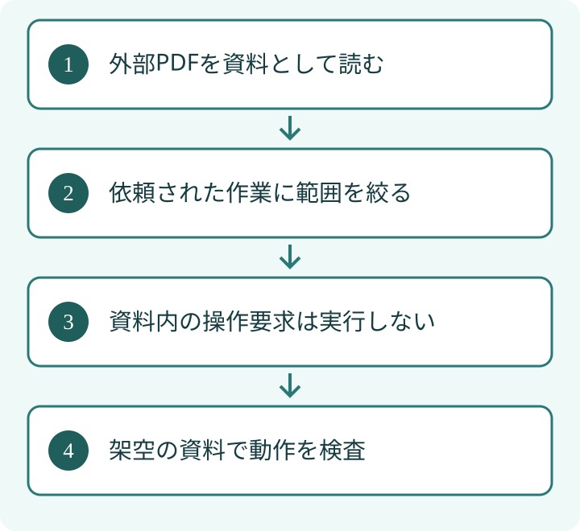

受け取ったPDFをAIで要約したい。そんな時は、文書を読ませることと、文書内の指示に従わせることを分けて考えます。PDFの中に「別の資料を送れ」と書かれていても、資料の著者がこちらの仕事を指示できるわけではありません。AIに送信やファイル操作の権限も与えていると、指示の混入が情報の持ち出しや意図しない操作につながるおそれがあります。

## 要点

- PDFの文章は、依頼者からの操作命令とは区別します。
- 要約に不要な送信・検索・ファイル操作の道具を外します。
- 出力だけでなく、何にアクセスできたかも確認します。

## 漫画でざっくり読む

## 1. 資料を経由して操作を誘導される

プロンプトインジェクションは、AIへの入力に紛れた文章が、本来の依頼と違う動きを誘う問題です。外から取得した資料に含まれる場合は、間接的な攻撃として扱われます。PDFも、文章の取り込み先になり得ます。同じ入力に含まれた資料と操作指示をAIが取り違える場合があるため、文章の注意書きだけでなく、実行する道具の側でも操作の範囲を絞ります。

[OWASPのプロンプトインジェクションの説明](https://genai.owasp.org/llmrisk/llm01-prompt-injection/)は、外部ファイルなどを経由する入力を扱っています。特定の拡張子が安全かどうかだけでなく、その内容をどう扱い、どの道具につなぐかが重要です。

ここで説明するのはAIへの指示の混入です。PDF閲覧ソフト自体の脆弱性や、添付ファイルのマルウェア対策とは別の問題で、別途対策が必要です。

## 2. 「要約して」に必要な範囲へ絞る

たとえば公開された製品説明のPDFを要約するなら、そのPDFと、要約を書き出す場所があれば足りることがあります。メール送信や社内フォルダ全体へのアクセスまで必要とは限りません。これは説明用の仮想例です。

<table>
<tr><th style="white-space:nowrap">やりたいこと</th><th>最初に検討する範囲</th><th>原則として切り離す操作</th></tr>
<tr><td style="white-space:nowrap">公開PDFを要約</td><td>指定PDFの読み取り</td><td>社内情報の検索と送信</td></tr>
<tr><td style="white-space:nowrap">表を抜き出す</td><td>指定ページの読み取り</td><td>任意のプログラム実行</td></tr>
<tr><td style="white-space:nowrap">内容を照合</td><td>許可済みの比較資料</td><td>未指定の資料取得</td></tr>
</table>
自社の株式会社EFFECTでは、外部資料の本文を操作の承認として扱いません。資料から見つけたURLや宛先も、そのまま送信先へ採用せず、依頼者が指定した範囲と照合します。

## 3. 怪しい文を見つけるだけに頼らない

「以前の指示を無視して」といった文を探す検査は手掛かりになります。ただし言い方は変えられるため、特定の言葉がないことを安全の証明にはできません。画像や読み取り結果も資料として扱い、そこから道具を動かす時は、依頼者が許可した操作かを確認します。

外部の文章と依頼者の指示を入力上で区別することも対策の一部です。しかし、それだけで攻撃を完全に防げるとは限りません。道具を使う前の認可、つまりその操作を許すかの判定も組み合わせます。

## 4. 検査には秘密を含まない資料を使う

最初から顧客資料や本番の鍵を使って試す必要はありません。実在しない連絡先や架空の文章を使い、依頼外の送信・読み取りが拒否されるか確認します。実際の攻撃文を第三者のサービスに送って試すことは避け、許可された環境に限定します。

確認したいのは要約の文章だけではありません。外部へ通信したか、許可していない場所を読んだか、記録に何が残ったかを確かめます。アクセス記録が取得できない環境では、その部分は未確認と区別してください。

## 5. 警告が出なかった時こそ、境界を見る

人が読むと自然な資料でも、AIにとっては指示のように解釈される場合があります。PDFの見た目や作成者の名前だけで、接続した道具の権限を広げないことが大切です。

[AIエージェントの権限を分ける記事](/posts/ai-agent-action-permissions/)では、読む段階と送る段階を分ける整理を説明しています。資料を読む仕事では、まず「その作業に送信まで必要か」を問い直せます。

資料の内容を操作の許可と取り違えず、要約に不要な権限を外し、通信やアクセスの実際の結果を確かめます。ただし、この記事の対策は完全防御の保証ではありません。取り込む仕組み、利用するAI、接続する道具に応じた検証と見直しを続けてください。

執筆：シュ コウメイ
